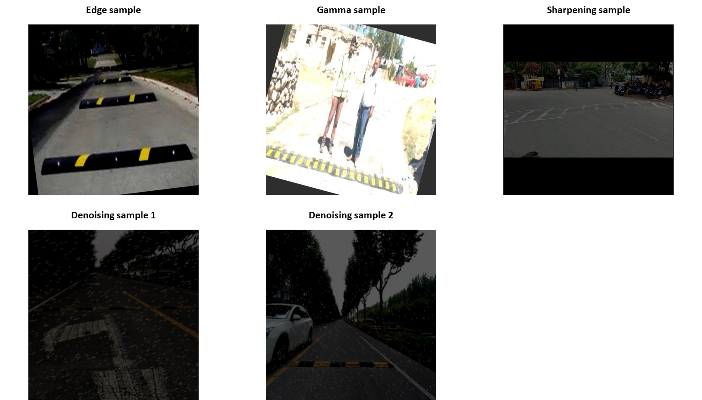
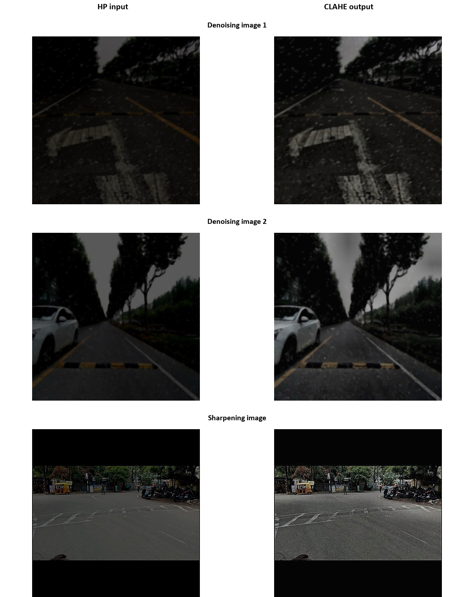

# Road Damage Image Processing and Detection with YOLO26s

This repository contains a digital image processing and six-class road-damage object-detection project. A preliminary OpenCV stage explores edge detection, point processing, spatial filtering, denoising, sharpening, and histogram enhancement. Selected processed images were then used to replace their corresponding source images in the cleaned dataset used to train Ultralytics YOLO26s in Google Colab.

## Project workflow

```text
Source road images
        |
        v
Preliminary OpenCV processing and parameter selection
        |
        v
Selected outputs replace corresponding source images
        |
        v
Cleaned six-class YOLO dataset
        |
        v
YOLO26s training and automatic best-checkpoint selection
        |
        v
Validation, held-out test evaluation, and predictions
```

## Detected classes

| ID | Class |
|---:|---|
| 0 | pothole |
| 1 | crack |
| 2 | debris |
| 3 | manhole |
| 4 | speed_breaker |
| 5 | road_barricade |

## Final performance

The automatically selected best checkpoint was evaluated on both validation and test splits.

| Split | Precision | Recall | mAP50 | mAP50-95 |
|---|---:|---:|---:|---:|
| Validation | 0.8771 | 0.8609 | 0.9045 | 0.6612 |
| Test | 0.8848 | 0.8588 | 0.9116 | 0.6839 |

Training ran for 60 epochs at an image size of 640. Detailed metrics are available in `results/training/final_metrics.json` and `results/training/results.csv`.

## Repository structure

```text
.
|-- Preli/
|   |-- Preliminary_Image_Processing.ipynb
|   |-- ED/, PP/, SF/, HP/
|   |-- outputs/
|   |-- figures/
|   |-- docs/
|   `-- README.md
|-- notebooks/
|   `-- YOLO26s_Road_Damage_Colab.ipynb
|-- configs/
|   |-- data.yaml
|   `-- data_colab.yaml
|-- scripts/
|   `-- split_yolo_drive_folders.ps1
|-- weights/
|   `-- best.pt
|-- results/
|   |-- training/
|   |-- validation/
|   |-- test/
|   `-- predictions/
|-- requirements.txt
`-- README.md
```

## Dataset

The full cleaned dataset is not stored in this repository because it contains more than 52,000 images. Selected outputs from the preliminary image-processing stage replaced their corresponding source images when the cleaned dataset was assembled. This repository does not claim that preprocessing improved detection accuracy because a separate original-dataset YOLO baseline was not trained for a controlled comparison.

For Colab reproduction, place the dataset in Google Drive using this layout:

```text
MyDrive/DIP/Project/Final/
|-- images/
|   |-- train/
|   |-- valid/
|   `-- test/
`-- labels/
    |-- train/
    |-- valid/
    `-- test/
```

The large train, validation, and test directories may contain `part_###` subfolders. The supplied notebook and YAML configuration support that organization.

## Preliminary image processing

The reproducible preliminary notebook is located at `Preli/Preliminary_Image_Processing.ipynb`.

| Operation | Selected method or parameter |
|---|---|
| Edge detection | Gaussian smoothing, Canny thresholds 50/150, morphological closing |
| Point processing | Gamma trials 1.4, 1.8, 2.2, and 2.6; selected gamma 2.2 |
| Sharpening | Unsharp masking with amount 1.0 |
| Denoising | Median kernels 3, 5, 7, and 9; selected 9, followed by bilateral filtering |
| Histogram processing | CLAHE on LAB luminance, clip limit 2.0, 8 x 8 grid |

The source examples, selected outputs, parameter-comparison figures, and preliminary report are included under `Preli/`. See `Preli/README.md` for details.





## Run YOLO26s in Google Colab

1. Upload the dataset to the Google Drive location shown above.
2. Open `notebooks/YOLO26s_Road_Damage_Colab.ipynb` in Colab.
3. Enable a GPU runtime.
4. Run the notebook cells in order.

The notebook mounts Google Drive, verifies the dataset, creates a Colab-specific YAML file, trains YOLO26s, automatically selects `best.pt`, evaluates validation and test data, and exports plots and metrics.

## Inference

```python
from ultralytics import YOLO

model = YOLO("weights/best.pt")
model.predict(source="path/to/image.jpg", imgsz=640, conf=0.25, save=True)
```

## Notes

- `weights/best.pt` is the final checkpoint intended for inference.
- Intermediate `epoch*.pt` checkpoints and `last.pt` are intentionally excluded.
- The complete image and label dataset remains outside GitHub because of its size.
- Preliminary DOCX, ZIP packages, and repeated report-QA renderings are intentionally excluded.

